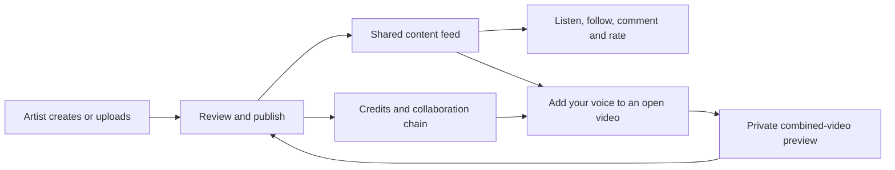

# GGenre: product map and improvement roadmap

Prepared 30 October 2026 from the current code and validation reports. Application baseline: GitHub commit 8050bce. This document plans future work; it does not change application behavior or deploy anything.

## Product direction

GGenre is a social platform where artists create, publish and grow songs together, and audiences discover, follow, discuss and rate the results. Acapella collaboration is a strong starting point, with Gospel and other music supported by the broader Studio.

The core journey is:

Artists create and collaborate; fans discover and engage; admins moderate, manage access and verify payments. Existing account/permission rules continue to apply.

## What is implemented

| Area | Current capabilities | Important boundary |
| --- | --- | --- |
| Accounts and community | Artist/fan/admin roles; registration/login; profiles; follows; dashboards; announcements and notifications. | Real onboarding and account-recovery usability still need pilot observation. |
| Shared content | File uploads and YouTube embeds; genres/tags/categories; moderation and visibility controls; unique views, comments and voting. | Ordinary file URLs and private Studio/collaboration media use different delivery paths; review access consistently. |
| Discovery | Main feed; artist pages; search through users/search; personalized/grouped Up Next; collaboration versions on source posts. | A dedicated search app is scaffolding, not an additional working search product. |
| Artist Studio | Multi-track vocals, shared-clock overdub, take review/cancel, trim/move/mute/gain, recovery, mixes and publication. | Browser/device latency and interruption behavior need physical-device acceptance. |
| Instrumental library | Piano, bass, chord, drum and full-band workspaces; sound palette/pads/toms; sections, song length, copy/paste/repeat/undo; private save and vocal-Studio reuse. MIDI/audio-input provisions. | Synthesized sounds; MIDI and interface hardware have not had physical acceptance testing. |
| Vocal-video collaboration | Explicit creator opt-in; Add your voice in the main feed and post; vocal roles; timing/balance; real MP4 preview; credited new post; further joins; saved preview library. | Uploaded MP4 with sound, five minutes/50 MB source limit, maximum 32 contributions. Original visual is retained; no new camera/split-screen recording. |
| Messaging | Peer and admin chat, WebSockets, media/history/unread indicators; access/unlock rules and admin support. | Multi-worker deployment and reconnect behavior need production-like testing. |
| Missions and engagement | Templates/custom instructions, opponents, timers, evidence submission, review controls/automation records, token requests and winner feed. | Review automation should be evaluated against real moderation cases; presence of automation code is not proof of decision quality. |
| Livestreaming | Stream creation/start/end, host/viewer rooms, access grants/revocation, browser video and WebSocket signaling. | Current WebRTC configuration shows STUN only. There is also an older content-live route, so live implementations need a deliberate parity/consolidation plan. |
| Monetization and admin | Manual subscription/payment review; upload/vote controls; first-two-free Studio exports; per-artist limit/usage/reset/unlimited export control; approval history and moderation queues. | Payments app contains unwired legacy Stripe code. It is not a completed automatic checkout integration. Subscription/quota rules need dedicated validation before paid rollout. |
| Mobile/PWA and speed | Responsive collaboration/feed/forms; manifest, service worker and offline route; private Studio routes bypass shared caches; query batching, indexes, private guide reuse and polling deduplication. | Viewport checks are not physical-phone certification; local benchmarks are not concurrent production-load results. |

## Architecture and ownership of data

- users owns identities, roles, follows, account notifications and voting policy.
- content owns the canonical public post, genre/tags, votes, comments and upload allowance. Collaborated videos join this same Content feed rather than a separate social feed.
- studio owns private projects/tracks/instrumentals, mix releases, export allowances/requests, video collaboration previews and contributor snapshots. A collaboration references its source post and resulting Content post.
- chatapp owns conversation access, messages, missions, evidence, review controls, purchase requests and winner-feed records.
- livestream owns the newer stream rooms/access grants; older live models/routes also remain in content.
- subscriptions owns the wired manual plan/payment flow. payments and search should be clearly labeled or retired as legacy/scaffold after confirming no dependencies.
- Django serves page/API requests; Channels/ASGI handles sockets; browser Web Audio/AudioWorklet handles Studio capture; local FFmpeg processes collaboration media. A render job queue is not yet implemented: video rendering currently runs within the request.

Keep Content as the shared publication point, Studio media private, and permission/quota checks authoritative on the server. Preserve existing URLs and behavior when reorganizing code.

## Evidence and limits

Completed local validation: 246 Django tests across users/content/chat/Studio, 113 JavaScript checks, and 56 layout checks across eight artist journeys and seven phone/tablet viewports. Broader regression used a test-process-only fast fixture hasher; login/registration were separately checked with the normal hasher. Three stale admin-copy assertions were changed to check actual review actions; admin UI was not changed.

Measured local workload: fifty-post feed queries 86 → 14; thirty-comment post queries 148 → 31. In the final local timing run, those pages were about 203 → 102 ms and 237 → 145 ms; repeated guide preparation was about 211 → 41 ms. These results do not establish a production concurrency ceiling.

The latest broad run did not include the livestream suite. Subscription/payment test modules have no meaningful test coverage currently. Physical phone microphones/cameras, hardware MIDI, unreliable networks, multi-instance operation and production storage/restore remain separate acceptance work.

## Prioritized roadmap

### Milestone 1 — private pilot readiness (P0)

Goal: a small group can complete the current collaboration journey reliably without losing work.

| Work | Why it comes first | Acceptance evidence |
| --- | --- | --- |
| Staging environment and rollback | Local success must translate to the deployed environment. | HTTPS/ASGI/socket checks; shared channel layer when using multiple instances; separate test data; migrations/static checks; backup restored successfully; rollback rehearsed. |
| Physical phone acceptance | Most users will record on phones. | Real Android/iPhone tests, including a lower-memory phone; headphones, permission denial, calls/interruptions, background/return, rotation, keyboard/form focus, delay correction and repeated takes. |
| Background video jobs | Current synchronous renders can occupy request capacity and fail when connections/processes are interrupted. | Persisted queued/running/ready/failed states; progress, resume/reopen and bounded retries; worker restart recovers stale work; one submission cannot create duplicate posts. Preserve the same artist journey. |
| Raw-take recovery and upload resilience | A saved combined preview exists, but an unrendered collaboration take currently lives in browser memory. | Explicit local recovery for unpublished vocals; interrupted upload can retry/resume; reload and network loss do not silently discard a take or create duplicates. |
| Consistent media authorization | Source/post visibility must have a clear meaning across upload types. | Test direct URLs for hidden/unapproved ordinary uploads as well as private collaboration media; verify access after source closure, removal and account suspension; fix delivery paths where needed. |
| Monitoring and load baseline | Regressions need to be observable before inviting more users. | Record render wait/time/failures, API p50/p95, socket reconnects, error rates and storage growth; concurrent pilot workload test with a documented capacity limit. |

Proposed pilot gate: no reproducible data loss, privacy leak, wrong-user access or quota/payment-accounting errors. At least four of five first-time artist testers should complete record → preview → submit without intervention. Confirm the target with the owner before treating it as a release contract.

### Milestone 2 — make collaboration effortless (P1)

Goal: users understand how to join and why to return.

1. Guided first collaboration: explain headphones, vocal role, count-in and timing with short contextual help; let users dismiss it permanently.
2. Song participation requests: let the creator name missing parts, for example bass, beatbox or alto, and show them beside Add your voice.
3. Clear collaboration tree: root song, each contributor and each version; give credit links and controls a consistent home.
4. Collaboration notifications: tell creators when a new approved version joins their song; support direct post invites and user-controlled notification settings. Implement this as a product feature; no messages are sent by this plan.
5. Moderation/takedown lifecycle: clear reporting, opt-in history, source closure/removal rules and admin tools for derivative posts, with audit records.
6. Save/share flow polish: title/caption defaults, draft names, useful failure messages and a clear return to the original song or the next version.

Gate: invited testers can find an open song, choose a needed part, add it, identify the original creator, and find the resulting post. Repeated support questions should become prioritized UI fixes.

### Milestone 3 — discovery and retention (P1, after pilot evidence)

- Improve search/filtering for genre, creator, open collaborations and requested vocal parts. Preserve existing ranking behavior unless a deliberate product change is approved and measured.
- Surface growing songs and approved recent versions within the shared feed; add following-oriented discovery if testers demonstrate a need.
- Use existing missions/challenges to invite participation in songs, with moderation and consent rules aligned.
- Add a clear personal creator hub for drafts, pending reviews, published songs, collaboration requests and export status.
- Measure whether these features increase completed collaborations rather than merely page views.

### Milestone 4 — paid and larger-scale operation (P1/P2)

- Reconcile upload/vote/export quota sources and the different meanings currently attached to suspension flags. Preserve current user entitlements during migration, with before/after accounting tests.
- Add subscription lifecycle coverage: pending/approved/rejected payments, expiry, repeated signals, duplicate approvals and emails, concurrent requests and admin-role permissions. Ensure an expired subscription deactivates once without a save/signal loop.
- Specify the payment workflow before choosing or enabling a gateway. Use verified server payment events and idempotent entitlements; do not activate the legacy success-redirect code as a payment authority.
- Add and run livestream socket/access tests; test across different real networks; address relay support and viewer-capacity limits before promoting large live sessions.
- Add repeatable CI for backend/client tests, migrations, query-count budgets and critical browser flows. Introduce media/storage lifecycle jobs and capacity alerts.

### Later enhancements (P2, driven by demand)

Second-camera or split-screen performances; richer vocal effects/mixing; more instrument sounds; collaboration prompts/challenges; larger live events and creator monetization tools. Each needs its own usability and device/capacity validation. These are not required to prove the current add-your-voice loop.

## Success measures

Start with a small, privacy-conscious event set: opened collaboration, recording started, take kept, preview requested/ready/failed, submission, moderation result and approved next version. Do not collect raw audio or unnecessary personal data in analytics.

Track funnel completion, time to first completed collaboration, failed/recovered takes, render p95 and queue wait, moderation turnaround, creators receiving a second contributor, repeat collaborating artists, and support issues by device/browser. Suggested pilot targets are hypotheses, not measured results or service guarantees.

## Recommended next work package

Run a private staging pilot and build resumable background rendering/raw-take recovery first. Use that evidence to prioritize onboarding, collaboration requests and discovery. Billing and livestream expansion get their own verification tracks instead of being assumed ready from the Studio tests.

Reference implementation reports: STUDIO.md, COLLABORATIONS.md, STUDIO_USABILITY.md, PERFORMANCE.md and PRODUCTION_CHECKLIST.md. This roadmap has not been committed or pushed automatically.
